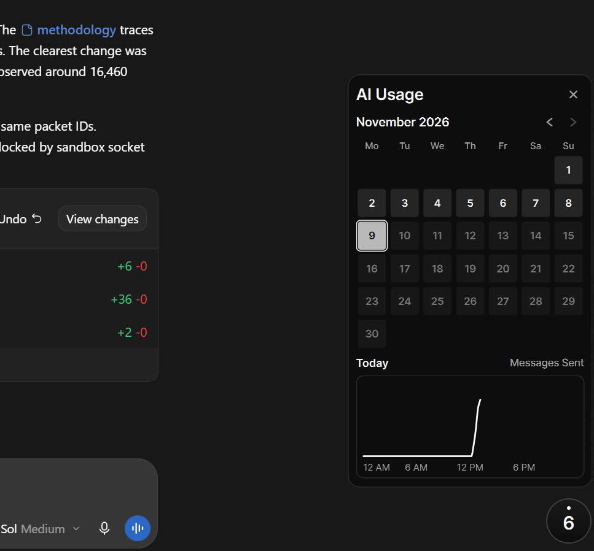

# AI Usage Widget

AI Usage Widget is a floating desktop counter for traffic that matches a ChatGPT message-start pattern. It shows today's detections, a monthly heatmap, and a per-day activity chart. It runs locally using packet metadata and stores its history in SQLite.



## Run on Windows

Install Python and Npcap for live capture. Open PowerShell in this repository and create an environment. The versions in `requirements.txt` were tested with Python 3.10.6.

```powershell
python -m venv .venv
.\.venv\Scripts\python.exe -m pip install -r requirements.txt
.\.venv\Scripts\python.exe start_widget.py --demo
```

Demo mode replays synthetic packet sequences through the same matcher and keeps history in memory. For live capture, run from an Administrator terminal and select the network interface you use.

```powershell
.\.venv\Scripts\python.exe start_widget.py --iface "Wi-Fi"
```

Omit `--iface` to use Scapy's default routing interface. Repeat `--local-ip ADDRESS` to override local address discovery. Use `--history PATH` to open a specific SQLite history file. By default, history is stored at `data/start_widget.sqlite3` relative to this repository.

Click the circle to open the calendar, use the arrows to change months, and select a date to view its activity. Drag the circle to move it and right-click it to quit.

## How the widget is made

- [`start_widget.py`](start_widget.py) builds the interface with PySide6 Qt Widgets. A custom-painted, always-on-top button opens a frameless history panel with a calendar and chart. The Qt timer refreshes the display every 750 ms when the history or local time changes.
- Scapy captures on a background thread. The worker passes each eligible packet's timestamp, captured length, direction, and endpoint tuple to the [detector](detector.py). Matching is per TCP connection across all remote IPv4 and IPv6 addresses and TCP ports on the selected interface. The interface reports capture errors and queue drops.
- SQLite stores one row per detected start, keyed by the first packet's timestamp and both IP and port pairs. Capture and UI use separate connections in WAL mode. The history includes endpoint metadata. Packet payloads and full capture files are excluded from storage.
- Calendar cells count starts by local date, with shading breakpoints at 1, 3, 6, and 10 starts. The chart counts starts in 15-minute local-time bins. It draws a five-bin weighted average with weights `1, 2, 3, 2, 1` renormalized at the edges and shows the raw count on hover.

## Methodology

1. **Label activity.** The research started with manually labeled packet windows, followed by a browser extension that recorded when chats started. A proxy later provided timestamps for the underlying HTTP requests and responses.
2. **Align and visualize.** Network packets and decrypted HTTP requests and responses were captured separately, loaded into SQLite, and aligned by time and connection. Log-scale plots of sent and received packet sizes revealed recurring patterns around known chat starts.
3. **Detect starts.** Those patterns informed a rule based on packet sizes and timing. The detector looks for two large outgoing packets, each quickly followed by a smaller one, on the same TCP connection. When the sequence matches, the widget records the time of the first packet as a likely chat start.

The widget currently shows when chat requests started. Further research could test whether packet patterns can reveal how long the AI streamed, roughly how many tokens were sent and received, which model was used, or how much context was sent.
